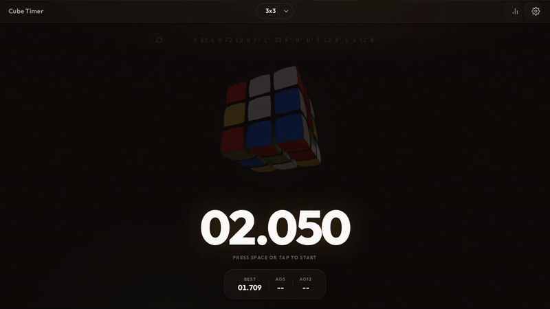

# Rubik's Cube Visualizer + Timer



A speedcubing timer in your browser that shows each scramble on a 3D cube, from 2x2 to 7x7.

```bash
git clone https://github.com/jayhemnani9910/rubiks-cube.git && cd rubiks-cube && npm install && npm run dev
```

Needs Node 20.19+ or 22.12+. Or skip the install and use the [live version](https://jayhemnani9910.github.io/rubiks-cube/).

[](https://github.com/jayhemnani9910/rubiks-cube/actions/workflows/ci.yml)
[](./LICENSE)

The times in the GIF come from a script pressing Space, not from a person solving a cube.

## Usage

Press `g` for a scramble, `Space` to start inspection, `Space` again to start the timer, and `Space` to stop. On a touch screen, tap the timer instead.

| Key | Action |
| --- | --- |
| `r` `l` `u` `d` `f` `b` | Turn a face clockwise |
| `Shift` + face key | Turn it counter-clockwise |
| Arrow keys | Rotate the view |
| `g` | New scramble |
| `z` | Reset the cube and clear the scramble |
| `Space` | Inspection, start, stop |
| `Escape` | Reset the timer, or close an open panel |

Pick the cube size at the top of the page. Everything else is in the two panels on the right:

- **Stats:** best, worst, mean, Ao5, Ao12, Ao100, your last 10 personal bests, solve history, a trend chart and a histogram. Each cube size and session has its own numbers, and Clear Session wipes only the ones you're looking at.
- **Settings:** inspection, sounds, dark or light theme, 2 or 3 decimals, sessions (new, rename, delete), the tutorial, and JSON export and import. Import replaces the data in your browser.

## How it works

It's a static Vite app with no backend. Three.js draws the cube and Chart.js draws the charts.

**Scrambles** are random moves from a list for each size. Two moves in a row never share an axis.

| Cube | Moves | Move set |
| --- | --- | --- |
| 2x2 | 11 | R U F |
| 3x3 | 20 | R L U D F B |
| 4x4, 5x5 | 40, 60 | adds wide moves (Rw) |
| 6x6, 7x7 | 80, 100 | adds triple-wide moves (3Rw) |

**Inspection** follows WCA timing: 15 seconds, then +2 up to 17 seconds, then DNF.

**Averages** drop the top and bottom 5%, rounded up. That's one solve from each end for Ao5 and Ao12, five for Ao100. Too many DNFs makes the average a DNF.

**Your data** stays in `localStorage`. There's no account, and your times don't leave your browser unless you export them.

**Offline:** a service worker caches the app, and you can install it as a PWA. Offline only works from your second visit on, because the worker caches the JS and CSS when it sees them requested.

Diagrams: [architecture](./docs/architecture.svg), [data flow](./docs/data-flow.svg), [modules](./docs/modules.svg). The D2 sources sit next to them.

## Contributing

See [CONTRIBUTING.md](./.github/CONTRIBUTING.md). To report a vulnerability, see [SECURITY.md](./.github/SECURITY.md).

## Credits and license

MIT, see [LICENSE](./LICENSE). This repo started from Vasu Gondaliya's [cube project](https://github.com/vasu-gondaliya/rubiks-cube), and his copyright notice stays in the license.
